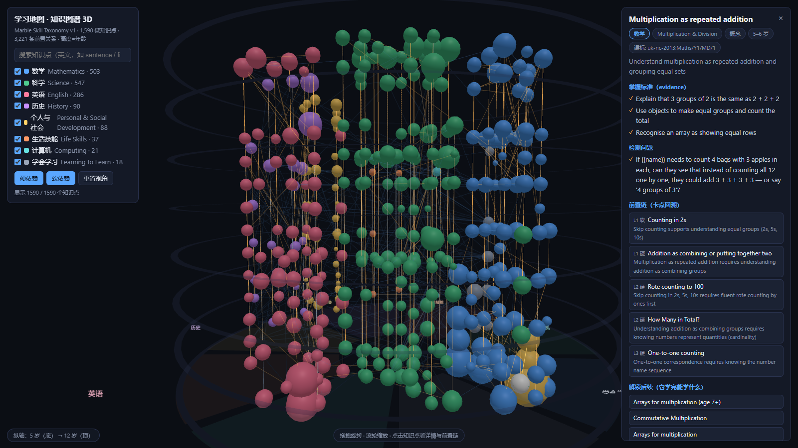

# 学习地图 · Learning Map

基于开源 **Marble Skill Taxonomy v1** 的学习知识图谱 + 3D 可视化 + 卡点回溯引擎骨架。

一句话：**把"孩子哪里不会"变成一条可以一路往前追原因的知识链，并把这条链画成能转、能点、能钻的 3D 世界。**

- 1,590 个微知识点（8 学科，5–12 岁）
- 3,221 条前置依赖（hard / soft，每条带原因）
- 每个知识点自带：描述、掌握标准（evidence）、检测问题（assessmentPrompt）、年龄区间、中心度

## 目录

```
data/                     上游数据集（Marble Skill Taxonomy v1，原样保留）
  topics.json             1,590 微知识点
  dependencies.json       3,221 条前置边
  curriculum-standards.json  3,261 条课标（许可受限，见下）
  clusters.json           183 条家长向领域摘要
schema/                   JSON Schema（校验用）
scripts/validate.mjs      上游校验脚本
scripts/gen_viz_data.py   把上游 JSON 压成浏览器可用的 viz/data.js
scripts/diagnose.py       卡点回溯诊断引擎（中文化 + 现场提问 + 三档判定）
viz/index.html            3D 可视化 + 卡点回溯（零构建、零 CDN、离线可跑）
viz/vendor/               three.js 本地副本（不依赖网络）
viz/data.js               压缩后的图谱数据（1.7MB）
sessions/                 诊断会话记录 + 可打印摸底单
docs/架构说明.md          数据模型 + 可视化设计 + 二次开发接口
docs/卡点回溯诊断方法.md  诊断方法、命令、实测性能、已验证/未验证边界
docs/市场分析与方向.md    市场规模、竞争格局、合规边界、我们的切入点
UPSTREAM_README.md        上游原始 README（数据集权威说明，保留）
PROVENANCE.md             上游课标许可逐条说明（商用必读）
```

## 跑起来



零依赖，直接开：

```bash
cd viz && python -m http.server 8000
# 浏览器打开 http://127.0.0.1:8000/index.html
```

也可以直接双击 `viz/index.html`（three.js 已本地化，无网络也能跑）。

交互：拖拽旋转 · 滚轮缩放 · 点击任意知识点 → 右侧展开它的**前置链（最多 4 层，带"为什么必须先学它"）**和**解锁后续**；左侧按学科过滤、英文搜索。

重新生成数据：

```bash
python scripts/gen_viz_data.py
```

## 卡点回溯诊断引擎（scripts/diagnose.py）

**不需要题库。** 上游的 `assessmentPrompt` 是"给老师的提问建议"，本地模型把它变成 7 岁孩子听得懂的中文现场题；家长转述孩子真实表现，模型判三档（会 / 半会 / 不会），沿前置链回溯定位卡点，并区分**能力缺口**（回头补地基）和**练习缺口**（直接练这个点）——这两种处方完全相反，传统测评分不开。

```bash
python scripts/diagnose.py screen  --subject Mathematics --age 7 --n 12  # 摸底单（可打印版存 sessions/）
python scripts/diagnose.py plan    --topic mt_glPPG-kTQY --depth 4       # 看前置链 + 每格怎么问
python scripts/diagnose.py session --topic mt_glPPG-kTQY                 # 现场一问一答，问到失败即停
python scripts/diagnose.py judge   --topic mt_xmmgAzxe5j --answer "孩子原话"
```

实测（本地 Strata 8088）：生成一道中文诊断题约 2 秒；14 层前置链全量预热 75 秒；缓存命中 0 秒。
自动中文化并判断对中国小学生 `适用 / 需调整 / 不适用`——例：英国货币 `Coin Values` 自动标记需换成人民币元角分，英文数词拼写自动标记中国不教。
方法、命令、已验证与未验证边界见 `docs/卡点回溯诊断方法.md`。

## 已验证（Playwright + headless Chromium 实测）

| 检查项 | 结果 |
|---|---|
| 数据加载 | 1,590 topics / 3,221 deps 全量载入 |
| 3D 画布 | canvas 1280×800，非背景像素 66.7%，15,876 种颜色 |
| 点击命中 | 投影坐标点击 → 详情面板打开 |
| 卡点回溯 | 「Multiplication as repeated addition」→ 5 层前置链 + 12 个解锁后续 + 3 条掌握标准 |
| 链内跳转 | 点前置节点成功跳转到「Counting in 2s」 |
| 学科过滤 | 关掉 Science → 1590 变 1043，边同步重算 |
| JS 报错 | 0 |

## 许可（商用前必读）

- 上游数据集：**ODbL 1.0**（数据库）+ **CC BY-SA 4.0**（Marble 原创文本）。
  - ODbL 区分 **derivative database**（你扩展/修改这份分类体系本身 → 衍生库必须继续 ODbL 开放）和 **produced work**（把它用进你的产品/模型/App → **产品归你，不必开源**）。
  - 结论：**可以商用、可以闭源做产品**；你欠的是「对分类体系本身的改进要回馈」+「署名」。
- `data/curriculum-standards.json` **不在** Marble 可再授权的范围内：NGSS / C3 / IB PYP 只给编号不给全文，全文需分别向 WestEd / NCSS / IBO 取得授权；Common Core 全文是目的受限许可。详见 `PROVENANCE.md`。
- 本项目 `viz/` 的原创代码（可视化、回溯算法、生成脚本）：MIT。
- 署名要求：*Marble Skill Taxonomy (v1) © Generative Spark, Inc. (Marble) · https://withmarble.com · ODbL 1.0 + CC BY-SA 4.0*

## 状态

- [x] 上游数据全量核验（数字逐条数过，与原帖一致）
- [x] 3D 可视化 + 前置链回溯，Playwright 全链路验证通过
- [x] 对话式诊断引擎（assessmentPrompt → 本地 LLM 中文现场提问 → 三档判定 → 卡点报告），模拟转述验证通过
- [ ] **真实儿童验证**：在自家孩子身上跑一次摸底 + 回溯，人工核对卡点判定是否与家长日常观察吻合 ← 当前唯一命门
- [ ] 中国教材映射（人教版 / 统编版）——真正的护城河工作，未开始
- [ ] 卡点 → 3D 课件联动（接 deck3d-courseware 引擎）
